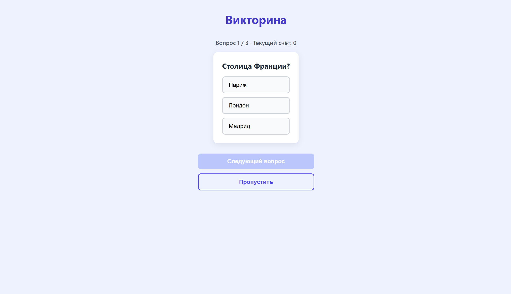
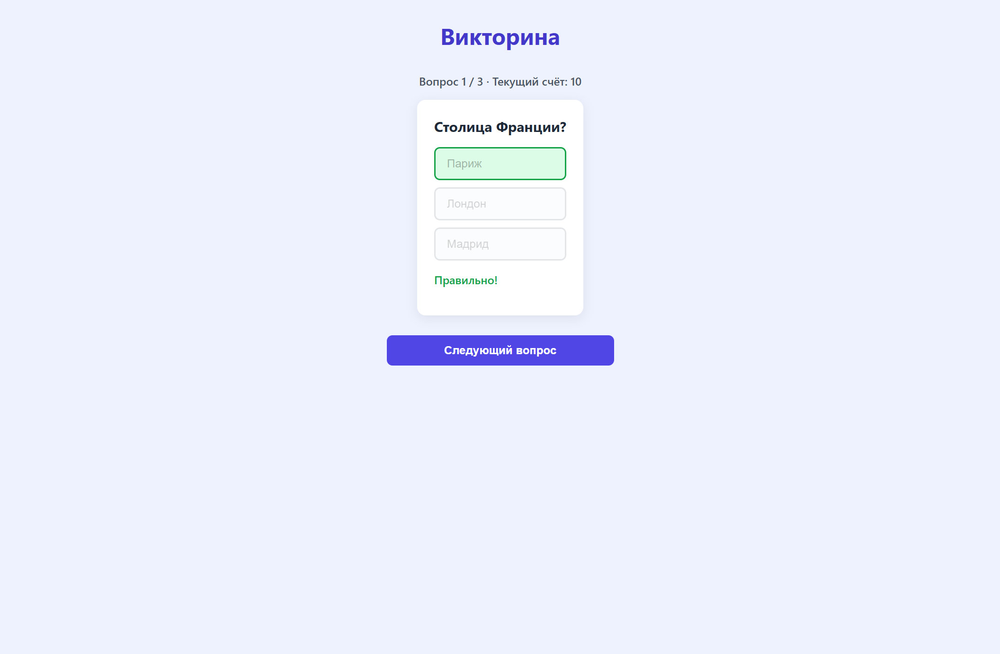
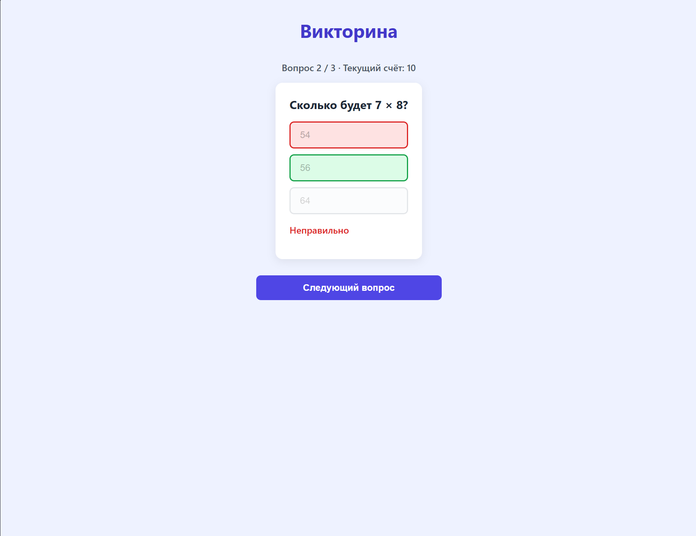
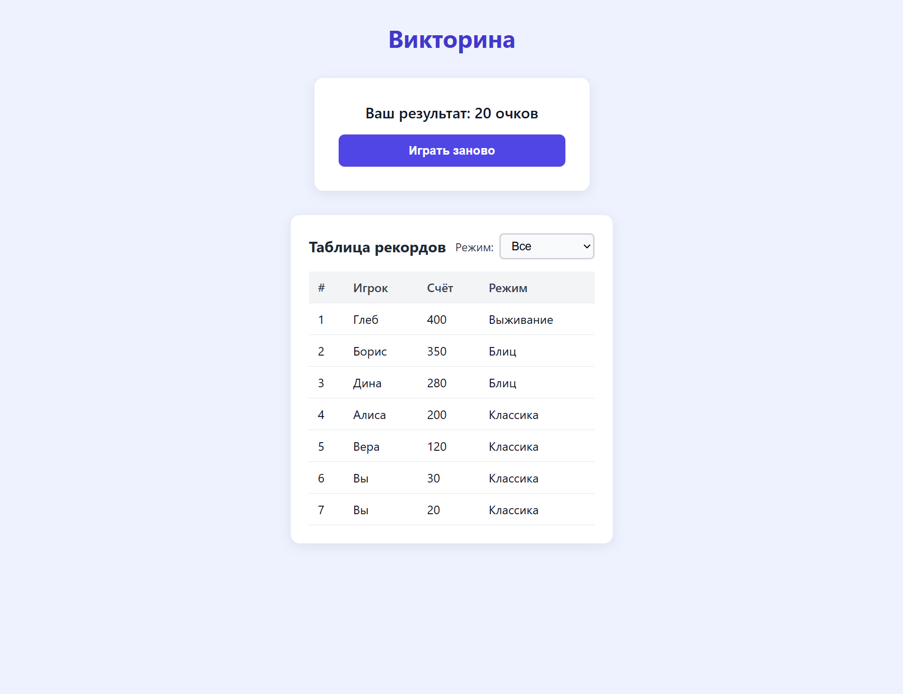
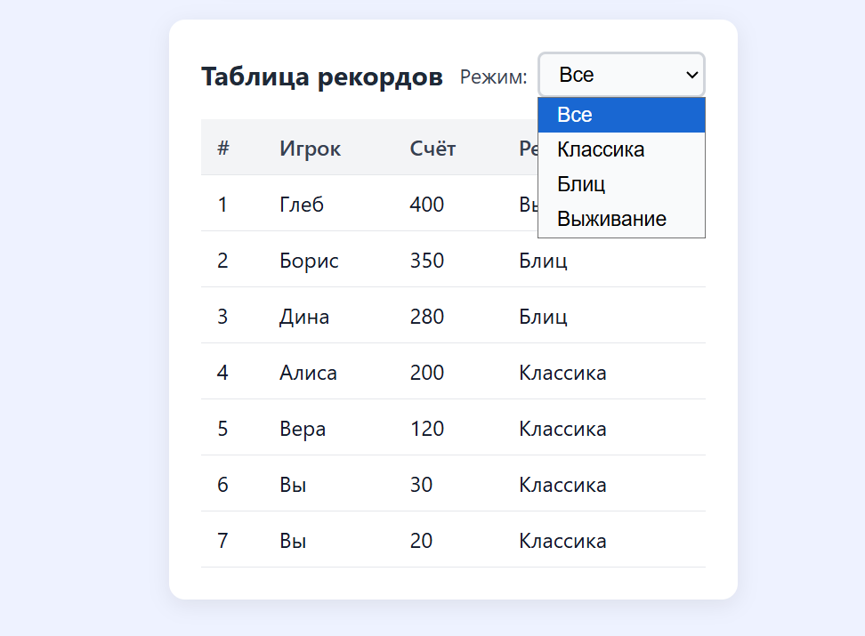

# Викторина (Quiz UI) — Лабораторная работа 4

## Описание проекта

Данный проект представляет собой веб-приложение — викторину, разработанную на React и TypeScript. В рамках лабораторной работы была создана библиотека UI-компонентов и продемонстрировано их применение

### Реализованные компоненты:

1. **Карточка вопроса (`QuestionCard`)**:
   - Отображает текст вопроса и варианты ответов
   - Позволяет выбрать один вариант
   - Показывает визуальную индикацию правильного и неправильного ответа (подсветка зеленым и красным цветом)
   - Блокирует повторный выбор ответа после того, как ответ уже дан

2. **Таблица рекордов (`Scoreboard`)**:
   - Отображает позицию, имя игрока, счет и режим игры
   - Содержит фильтрацию по режиму игры (Классика, Блиц, Выживание)
   - Сортирует игроков по убыванию счета
   - В приложении таблица появляется только после завершения прохождения викторины. В нее добавляются результаты пользователя, а также изначально присутствуют результаты случайных игроков

### Игровая механика:
- Пользователь проходит викторину
- Нельзя перейти к следующему вопросу, не выбрав ответ (кнопка блокируется)
- Если пользователь не уверен в ответе, он может нажать кнопку «Пропустить»
- После прохождения всех оставшихся вопросов программа автоматически вернет пользователя к пропущенным вопросам
- По завершении всех вопросов показывается итоговый счет и таблица рекордов

## Стек технологий

- **React 18** (функциональные компоненты, хуки)
- **TypeScript** (строгая типизация, без использования `any`)
- **Vite** (сборка и dev-сервер)
- **Jest + React Testing Library** (тестирование)
- **ESLint** (линтер с настроенными правилами)
- **Чистый CSS** (без сторонних UI-библиотек)

## Инструкция по запуску

1. Откройте терминал и перейдите в папку с проектом:
   cd C:\Users\rmusl\js-lab\lab4-react\solutions\student-16
2. Установите необходимые зависимости (это нужно сделать один раз при первом запуске):
    npm install
3. Запустите сервер разработки:
    npm run dev
4. В терминале появится ссылка (обычно http://localhost:5173/). Зажмите клавишу Ctrl и кликните по ней левой кнопкой мыши, чтобы открыть приложение в браузере

Дополнительные команды:
1. npm run build — сборка production-версии проекта (проверка на ошибки)
2. npm run lint — проверка кода линтером ESLint
3. npm run lint:fix — автоматическое исправление ошибок ESLint
4. npm run test — запуск тестов
5. npm run test:coverage — запуск тестов с отчетом о покрытии

## Скриншоты

1. 
2. 
3. 
4. 
5. 